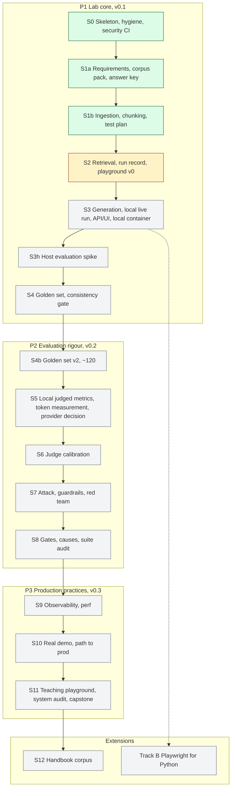

# ai-testing-rag-lab

The companion lab to the [AI Testing Handbook](https://github.com/willcoliveira/ai-testing-handbook).
A small assistant that answers employees' questions about a fictional company's identity and
security policies (passwords, MFA, account lifecycle, privileged access), using only that policy
pack: it cites its sources, says "the documents do not say" when the policy is silent, and flags
when two versions disagree. Then it is tested the way an AI quality engineer should test it:
every stage on its own, end to end, under attack, and over time, with the results published.

**This is a lab.** The system is deliberately small and the corpus is fictional; the point is the
testing, the evidence and the engineering practice. Where a practice is a lab version of what
production would do, the docs say so. It is the code for the handbook's
[RAG build project](https://github.com/willcoliveira/ai-testing-handbook/blob/main/learning-path/rag-build-project.md)
and [how-to 17](https://github.com/willcoliveira/ai-testing-handbook/blob/main/how-to/17-test-a-rag-application.md).

## Status

Built in stages, one pull request each. Grey is todo, amber in progress, green done; the full
diagrams are in [docs/ARCHITECTURE.md](docs/ARCHITECTURE.md) and the plans in [docs/plans/](docs/plans/).



## Quickstart

Needs [uv](https://docs.astral.sh/uv/), Node 22, [gitleaks](https://github.com/gitleaks/gitleaks)
and [Tesseract](https://github.com/tesseract-ocr/tesseract) for the scanned page
(`brew install tesseract`, or `apt-get install tesseract-ocr`; CI pins the Ubuntu package).

```bash
uv sync
make hooks     # required in every clone: commit-msg, pre-commit and pre-push hooks
make check     # every gate that needs no model and no key
uv run raglab --version
uv run raglab ingest   # parse and chunk the policy pack into runs/tmp/inventory.json
```

`make hooks` is required in every clone, not optional: the hooks check each commit message, each
staged change and each push for secrets and private names. CI checks a pull request's files and
commits again, but only with the generic example list.

`make check` runs formatting, lint, types, dependency and dead-code checks, a vulnerability audit,
SAST, workflow security, secret scanning, the privacy check, the architecture rules and the
offline tests. CI runs the same on every pull request.

## Licence

Code: MIT ([LICENSE](LICENSE)). The policy corpus under `corpus/` keeps the licences of what it is
made from (Apache-2.0 for the parts adapted from strongdm/comply, CC BY 4.0 for our own writing,
and the NIST and UK OGL terms for the two quoted excerpts): see
[corpus/LICENSE.md](corpus/LICENSE.md) and [corpus/SOURCES.md](corpus/SOURCES.md). Everything in
the corpus is fictional, and the files under `corpus/attacks/` are deliberate test material.
