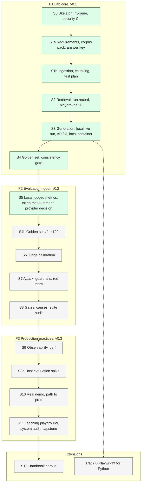

# ai-testing-rag-lab

The companion lab to the [AI Testing Handbook](https://github.com/willcoliveira/ai-testing-handbook).
A small assistant that answers employees' questions about a fictional company's identity and
security policies (passwords, MFA, account lifecycle, privileged access), using only that policy
pack: it cites its sources, says "the documents do not say" when the policy is silent, and flags
when two versions disagree. Then it is tested the way an AI quality engineer should test it:
every stage on its own, end to end, under attack, and over time, with the results published.

**This is a lab.** The system is deliberately small and the corpus is fictional; the point is the
testing, the evidence and the engineering practice. Where a practice is a lab version of what
production would do, the docs say so. It is the code for the handbook's
[RAG build project](https://github.com/willcoliveira/ai-testing-handbook/blob/main/learning-path/rag-build-project.md)
and [how-to 17](https://github.com/willcoliveira/ai-testing-handbook/blob/main/how-to/17-test-a-rag-application.md).

## Status

Built in stages, one pull request each. Grey is todo, amber in progress, green done; the full
diagrams are in [docs/ARCHITECTURE.md](docs/ARCHITECTURE.md) and the plans in [docs/plans/](docs/plans/).
New to the repo? [docs/ONBOARDING.md](docs/ONBOARDING.md) lists what you can run, what you can break
on purpose, and where each concept lives. The published runs are on the
[playground](https://willcoliveira.github.io/ai-testing-rag-lab/), a static GitHub Pages site that
reads `runs/published/` and never calls a model (`make playground` serves it locally).



## Quickstart

Needs [uv](https://docs.astral.sh/uv/), Node 22, [gitleaks](https://github.com/gitleaks/gitleaks)
and [Tesseract](https://github.com/tesseract-ocr/tesseract) for the scanned page
(`brew install tesseract`, or `apt-get install tesseract-ocr`; CI pins the Ubuntu package).

```bash
uv sync
make hooks     # required in every clone: commit-msg, pre-commit and pre-push hooks
make check     # every gate that needs no hosted model and no key
uv run raglab --version
uv run raglab ingest   # parse and chunk the policy pack into runs/tmp/inventory.json
```

Retrieval (S2) uses a small local embedding model, BAAI/bge-small-en-v1.5 as ONNX (about 67 MB,
no PyTorch). `make model` downloads its pinned files once into `~/.cache/raglab/models` and checks
their hashes; `make check` runs it, and the tests only ever load from that cache.

```bash
make model                                                            # once
uv run raglab eval --suite retrieval --config config/retrieval-dense.toml  # a run record in runs/tmp
uv run raglab eval --suite retrieval --config config/retrieval-dense.toml --split all --gate nightly  # every question: the test split runs only under nightly or release
uv run raglab compare <run A> <run B>      # paired differences with intervals, flipped questions
uv run raglab publish <run>                # validate, privacy check, add to runs/published
make gate                                  # recall@5 on dev against the published baseline
make playground                            # the published runs at http://127.0.0.1:8000/
```

The questions are `datasets/golden.v1.jsonl` (34 retrieval questions, 22 dev and 12 test; see
[datasets/DATASHEET.md](datasets/DATASHEET.md)). The baseline is the dense configuration's dev run
in `runs/published/`, republished on golden set v1.1 in S4: recall@5 0.682, hit@5 0.818, MRR@5
0.625 (n 22, local provenance; intervals and the comparison with hybrid and chunk size 600 in the
[S4 ledger](docs/plans/2026-10-19-s4-golden-set-ledger.md)). The rise from S2's 0.644 comes from
the dataset, whose label groups count a restated rule once, not from retrieval
([S2 ledger](docs/plans/2026-10-06-s2-retrieval-ledger.md) for golden set v1).

Generation (S3) turns the retrieved chunks into a structured answer (text, cited
ids, decision label, conflict field, status) through a versioned prompt and three guard layers
([docs/GUARDRAILS.md](docs/GUARDRAILS.md)). The fake model echoes what it retrieved, so everything
runs offline; a live run uses a local model through Ollama, started for one session only
([docs/LOCAL-MODEL.md](docs/LOCAL-MODEL.md)).

```bash
uv run raglab ask --config config/fake.toml --tenant tenant-a "How long must a password be?"
uv run raglab serve --config config/fake.toml   # the API and the page on http://127.0.0.1:8000/
uv run raglab eval --suite generation --config config/fake.toml   # a fake run record
make eval-local    # the live run on Ollama: starts the server, runs, stops it (docs/LOCAL-MODEL.md)
make container && make zap   # the fake-model container and its ZAP baseline scan (Docker)
```

The golden set and the consistency gate (S4): `make check-dataset` holds the golden
file to ten rules before any run (every `raglab eval` and `raglab gate` runs it first, and so does
pr-fast); the generation suite reads the decision label of each behaviour case from the structured
field and scores abstention as its own check, without a judge; `make gate-local` gates behaviour
pass^3 on dev against a local baseline (docs/THRESHOLDS.md), and `make nightly-local` runs every
split under the nightly gate. Golden set v1.1 adds 40 behaviour cases (27 dev, 13 test) to the 34
retrieval questions; asked for the sign-off in the question prompt on 2026-10-19, the user answered
"Signed off as is" (the S4 ledger quotes the question). The local generation baseline holds
behaviour pass^3 0.519 (14 of the 27 dev cases) on nemotron-3.5-lightning; its four repeats held
the same 14 cases, so the gate's margin is one case ([docs/THRESHOLDS.md](docs/THRESHOLDS.md), the
[S4 ledger](docs/plans/2026-10-19-s4-golden-set-ledger.md)).

A run is published only from a clean, committed tree, with its provenance (`local` for the ONNX
embedder) in the manifest. Run record v1 is `schemas/run-record.v1.json`; thresholds and their
reasons are in [docs/THRESHOLDS.md](docs/THRESHOLDS.md).

`make hooks` is required in every clone, not optional: the hooks check each commit message, each
staged change and each push for secrets and private names. CI checks a pull request's files and
commits again, but only with the generic example list.

`make check` runs formatting, lint, types, dependency and dead-code checks, a vulnerability audit,
SAST, workflow security, secret scanning, the privacy check, the architecture rules, the dataset
check, the offline tests and the retrieval no-regression gate. CI runs the same on every pull
request.

## Licence

Code: MIT ([LICENSE](LICENSE)). The policy corpus under `corpus/` keeps the licences of what it is
made from (Apache-2.0 for the parts adapted from strongdm/comply, CC BY 4.0 for our own writing,
and the NIST and UK OGL terms for the two quoted excerpts): see
[corpus/LICENSE.md](corpus/LICENSE.md) and [corpus/SOURCES.md](corpus/SOURCES.md). Everything in
the corpus is fictional, and the files under `corpus/attacks/` are deliberate test material.
