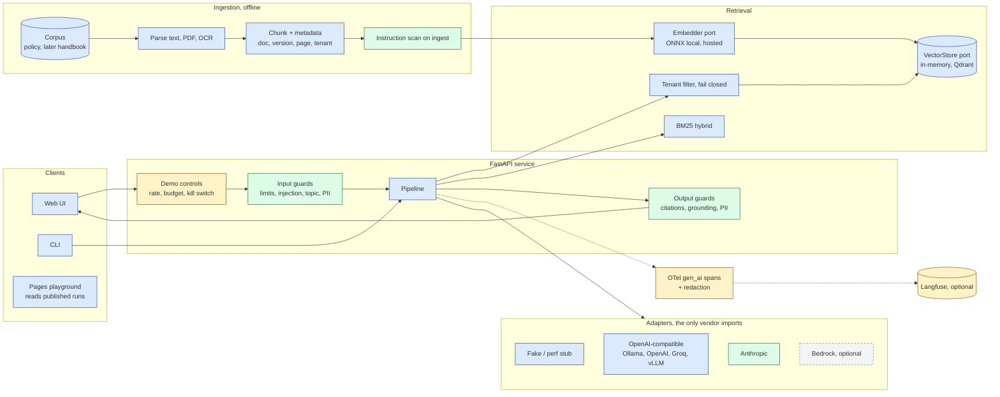
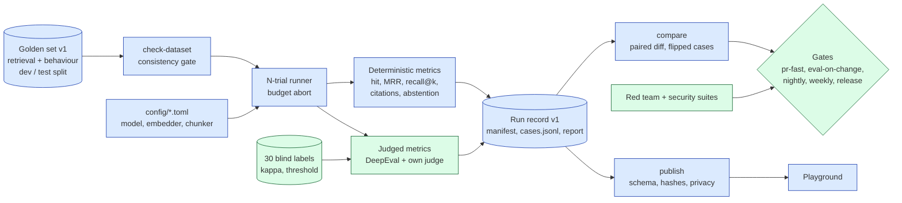
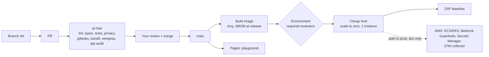
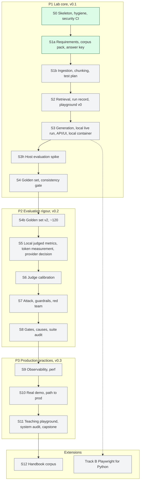

# Architecture

The system, its evaluation loop, its delivery path and the stage map, as Mermaid diagrams
(GitHub renders them). These diagrams are the progress map: every stage PR moves its nodes in
diagram 4 from `todo` to `wip` to `done`, and `tests/unit/test_diagram.py` checks that every node a
stage plan names exists here and that each node has exactly one status.

Colours in diagrams 1 to 3 show the phase that builds each part: blue P1 lab core, green P2
evaluation rigour, amber P3 production practices, grey dashed P4 documented only (the path to
production, not built). In diagram 4, grey is todo, amber is in progress, green is done.

### 1. Full system (runtime)

Key: blue P1 lab core, green P2 evaluation rigour, amber P3 production practices, grey dashed
P4 documented only.

### 2. Evaluation and gates (offline)

### 3. Delivery and deploy

### 4. Phase map (what each phase builds)

