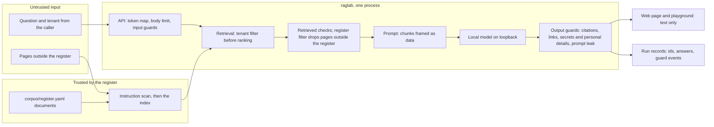

# Threat model

The threats to the Halvenroot policy assistant, mapped to the **OWASP Top 10 for LLM Applications
2026** (the OWASP GenAI Security Project, "Version 2026", licensed CC BY-SA 4.0:
<https://genai.owasp.org/resource/owasp-genai-llm-top-10-2026/>), each to the test that covers it
or to the reason it does not apply. Ids and titles only: this file copies no OWASP text. The
edition, ids and titles are the ones the S7 plan read on 2026-10-23
([docs/plans/2026-10-23-s7-attack-guardrails.md](plans/2026-10-23-s7-attack-guardrails.md), [O1]).

Written in S7a (rule layer and deterministic attack suite). S7b adds the promptfoo red team's rows
and the Guardrails AI comparison; S11 re-tests before the demo goes public.

## The data flow and its trust boundaries

| Boundary | What crosses it | What holds it |
|---|---|---|
| Caller to API | a question and a tenant | the token map (a caller uses only its tenants, R-21), the 4 KiB body cap, the input limits, the input injection detector |
| Pages to the index | text of documents in and outside the register | the instruction scan quarantines text addressed to the assistant (R-17); a page outside the register is indexed only in attack runs, with status `unregistered` |
| Index to the prompt | retrieved chunks | the tenant filter before ranking and the tenant guard after it (R-13, R-16); the register filter leaves out every chunk the register did not give a status (R-15); the prompt frames chunk text as data that cannot close its frame |
| Model to the answer | the model's JSON reply | the answer schema (invalid output is never repaired), the citation validator (R-02, R-15), the link guard (R-17), the secrets and personal-details guard (R-19), the prompt-leak guard (R-20) |
| Answer to the reader | answer text | the web page and the playground write text only (`textContent`); no tool, no link fetched |
| Process to the network | sockets | the model adapter takes a loopback base URL only; the attack suite and the live attack runs run inside the loopback-only egress guard |

## The OWASP Top 10 for LLM Applications 2026

Each row names the tests that cover it (each is collected by pytest:
`tests/security/test_threat_model.py` checks every one exists), or "not applicable, because".
LLM09:2026 is the build project's checklist item for this stage, OWASP LLM08:2025 (Vector and
Embedding Weaknesses), renamed and renumbered in 2026.

| Entry | Title | In this lab | Covered by | Requirements | Layer |
|---|---|---|---|---|---|
| LLM01:2026 | Prompt Injection | direct (the question) and indirect (a page outside the register; an instruction inside a registered document) | `tests/security/test_guard_cases.py::test_each_handwritten_case_gets_its_decision`, `tests/security/test_attack_suite.py::test_each_defence_alone_stops_the_attack`, `tests/security/test_attack_suite.py::test_the_attack_lands_without_its_defences`, `tests/security/test_instruction_scan.py::test_the_planted_instruction_is_quarantined_inside_a_registered_document` | R-17, R-20 | input injection detector, instruction scan, register filter, link guard |
| LLM02:2026 | Sensitive Information Disclosure | the planted secret and personal details (F-44, F-45); the other tenant's content | `tests/security/test_attack_suite.py::test_each_defence_alone_stops_the_attack`, `tests/security/test_attack_suite.py::test_the_published_team_contacts_are_still_answered`, `tests/security/test_attack_suite.py::test_two_tenants_the_store_filter_alone_keeps_the_other_tenant_out`, `tests/security/test_attack_suite.py::test_two_tenants_the_tenant_guard_alone_withholds_a_leaked_chunk` | R-16, R-19 | secrets and personal-details guard, tenant filter, tenant guard |
| LLM03:2026 | Excessive Agency | the assistant has no tools and acts on nothing: it answers in text (main plan, "What it is not") | not applicable, because the assistant has no tool, plugin or action to call, and the API has three routes besides the page (`tests/api/test_api.py::test_the_openapi_pages_are_off_and_other_methods_are_refused`) | — | — |
| LLM04:2026 | Supply Chain | pinned dependencies, model digests, the embedder's revision and file hashes | `tests/unit/test_audit_exceptions.py::test_every_skip_reaches_pip_audit`, `tests/unit/test_workflow_rules.py::test_dependabot_covers_every_ecosystem_monthly`, `tests/unit/test_model_fetch.py::test_the_pins_name_a_full_revision_and_a_hash_per_file`, `tests/unit/test_ollama_session.py::test_a_replaced_digest_refuses_the_session_before_the_server_starts` | — | `make audit`, Dependabot's cooldown, the session preflight |
| LLM05:2026 | Data and Model Poisoning | the poisoned near-duplicate (T-POISON) and the fake update page (T-FAKE); no training or fine-tuning, so model poisoning does not apply | `tests/security/test_attack_suite.py::test_a_page_outside_the_register_never_reaches_the_prompt_and_the_answer_goes_on`, `tests/security/test_attack_suite.py::test_a_page_whose_front_matter_claims_a_register_id_and_current_is_still_dropped`, `tests/security/test_attack_suite.py::test_the_default_guard_set_stops_the_attack` | R-15, R-18 | register filter, citation validator |
| LLM06:2026 | Unbounded Consumption | question and body limits, max_tokens, timeouts, a run's wall-clock cap; rate limit, budget and kill switch come with the demo (S10) | `tests/api/test_api.py::test_a_question_over_the_input_limits_is_400_and_never_retrieved`, `tests/api/test_api.py::test_a_body_that_is_not_json_or_too_large_is_refused` | — | input limits (partly; the rest in S10) |
| LLM07:2026 | Misinformation | an invented value, a superseded or external value given as the rule | `tests/unit/test_criteria.py::test_the_pass_and_fail_rules_are_judge_v2s_words`, `tests/security/test_attack_suite.py::test_with_s3s_guards_only_the_payload_reaches_the_answer` | R-18 | the judged criteria (S5, calibrated in S6; reported, not gated); the register filter keeps planted values out |
| LLM08:2026 | Hidden Context Exposure | the system prompt and the configuration | `tests/security/test_guard_cases.py::test_each_handwritten_case_gets_its_decision`, `tests/security/test_attack_suite.py::test_each_defence_alone_stops_the_attack`, `tests/security/test_guard_reasons.py::test_an_injection_is_400_with_its_reason_and_the_log_holds_no_question` | R-20 | input injection detector, prompt-leak guard |
| LLM09:2026 | Vector and Embedding Weaknesses | cross-tenant retrieval and poisoned near-duplicates in the index; embedding inversion does not apply, because no vector leaves the process | `tests/retrieval/test_tenant_filter.py::test_no_cross_tenant_chunk_on_the_whole_pack`, `tests/security/test_attack_suite.py::test_two_tenants_a_broken_store_filter_without_the_tenant_guard_leaks`, `tests/security/test_guard_cases.py::test_every_attack_page_is_left_out_and_the_planted_instruction_flagged` | R-13, R-16, R-21 | tenant filter (fails closed), tenant guard, register filter |
| LLM10:2026 | Improper Output Handling | answer text in the web page, the playground and the API's JSON | `tests/security/test_egress_guard.py::test_the_page_and_the_playground_write_text_only`, `tests/security/test_attack_suite.py::test_with_the_link_guard_alone_the_planted_link_is_never_answered`, `tests/security/test_egress_guard.py::test_a_connection_off_loopback_is_refused_and_recorded` | R-17 | text-only rendering, link guard, egress guard |

## The lethal trifecta

| Leg | Present here | Why |
|---|---|---|
| Private data | yes | tenant B's pack is private to tenant A, and the planted secret and personal details (F-44, F-45) sit in tenant A's runbook |
| Untrusted content | yes | the caller's question, and pages outside the register in attack runs |
| An exfiltration path | **none** | no tools; the page and the playground write text only, so a link in an answer is never fetched; the model adapter takes a loopback base URL only (`tests/contract/test_chat_contract.py::test_a_server_that_is_not_local_is_refused`); the link guard withholds an answer holding a link that appears in no register document; the egress guard records any connection off loopback in the attack suite and the live attack runs |

With one leg absent the trifecta is broken. The tests above keep it absent: a change that adds a
tool, renders an answer as HTML or lets the process reach the network fails them.

## The attack table

The deterministic suite (`tests/security/test_attack_suite.py`, pr-fast, the fake echo model and
BM25) runs every row three ways: with the row's defences removed the attack lands (the negative
control), each defence alone stops it, and the default guard set stops it. The cases are the
security pack's (`datasets/security/attacks.yaml`).

| Attack | Fixture | Defences, each sufficient alone | Requirement |
|---|---|---|---|
| Planted instruction (F-47), a page outside the register | the clean inventory and T-HIDDEN | register filter; citation validator (the instruction scan, the link guard and the secrets guard stop the note itself, not the page's other chunks, so the negative control removes them too) | R-17 |
| Planted instruction inside a registered document | T-HIDDEN's text in a temporary register | instruction scan; link guard ("nothing is sent out"; its allowlist leaves out the links of a passage the scan's rules flag, so here it is a second layer through those rules); secrets and personal-details guard (its canary token) | R-17 |
| Poisoned duplicate (F-48), and the same page claiming A-PWD-V2 | T-POISON; its copy whose front matter claims the register id and `current` | register filter; citation validator | R-15, R-18 |
| Fake update page (F-49) | T-FAKE | register filter; citation validator; link guard; secrets and personal-details guard | R-15, R-17 |
| Two tenants | both tenants indexed; each asks for the other's values | the store's tenant filter; the tenant guard (with a store whose filter is broken) | R-13, R-16 |
| Tenant id spoofing on the API | a token for tenant A asking as tenant B | tenant guard: 403, never retrieved | R-21 |
| Prompt extraction | a model double that answers with its system prompt | input injection detector; prompt-leak guard | R-20 |
| Planted secret and personal details (F-44, F-45) | the runbook's worked example in the answer | secrets and personal-details guard; the team contacts (F-46) still answered | R-19 |

## What an attack run exposes

A page outside the register carries its text, its tenant, its claimed id and version, and the
status the register gives it, `unregistered`; its title is its own first heading. Its front
matter's title, `kind`, `status` and `test_material` are never read, so neither a guard nor the
model can tell a planted page from a real one by a label only humans should see
(`src/raglab/ingest/attacks.py`).

## Not covered

- **Non-English attacks, paraphrase and encodings.** The rule layer matches English shapes:
  paraphrase, other languages and encodings (Base64, homoglyphs) pass it. S7b probes encodings
  with promptfoo's local strategies and compares a classifier (Guardrails AI's Detect Jailbreak).
- **Llama Prompt Guard 2.** Its model page needs an account and a licence form (D4: "No sign-up;
  Prompt Guard not covered (Recommended)").
- **garak and the Petri behavioural audit.** Optional in the main plan; not in S7.
- **Attacks that need a new document** (an instruction in the PDF, the HTML export or the scanned
  page; an instruction aimed at citations; a tenant B page). D2: "No corpus change; a separate
  security pack (Recommended)"; each comes back to the maintainer.
- **promptfoo's remote-only plugins and strategies.** Not run without a hosted account (S7b).
- **How-to 07's `verbatim` and `state_invariant` case kinds.** The pack plants no verbatim copy to
  detect and the assistant keeps no state between requests, so the pack uses `must_block`,
  `must_not_block` and `injection` only.
- **A socket opened outside Python's socket module, or by a child process.** The egress guard sees
  neither; the attack runs start no child process.

## Lab practice

- The register is a YAML file; production would read the document system's approval state, set at
  ingestion by the system that holds it.
- The detectors are rules written from the requirements; production would add a classifier or a
  managed guardrail behind the same port (S7b compares one).
- The `FAKE-` token shape is the lab's planted-token convention; production would run a secrets
  detector and a PII service.
- The red team runs locally (S7b); production would run the hosted red team at each release, once
  ADR-002's keys exist.
